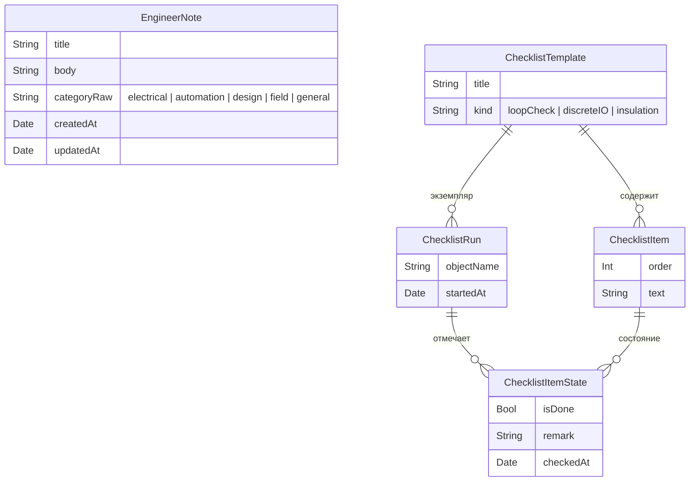

# ERD — локальное хранилище (SwiftData)

Справочные данные (таблицы датчиков, автоматы, IP-коды) — статичные Swift-структуры в бандле, в БД не хранятся.

| Сущность | Статус |
|---|---|
| `EngineerNote` | реализовано (`Core/Persistence/EngineerNote.swift`) |
| `Checklist*` | следующая итерация (модуль чек-листов ПНР) |
