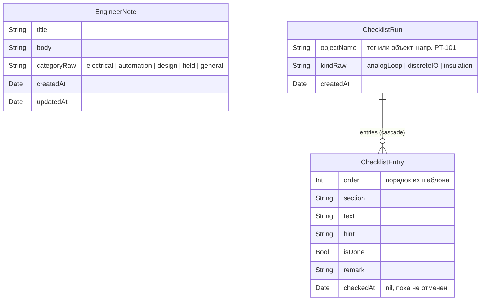

# ERD — локальное хранилище (SwiftData)

Справочные данные (шаблоны чек-листов, таблицы датчиков, автоматы, IP-коды) — статичные Swift-структуры в бандле, в БД не хранятся. При создании чек-листа пункты шаблона копируются в `ChecklistEntry`, поэтому правка шаблона в новой версии приложения не меняет уже начатые чек-листы.

| Сущность | Файл |
|---|---|
| `EngineerNote` | `Core/Persistence/EngineerNote.swift` |
| `ChecklistRun`, `ChecklistEntry` | `Features/Checklist/ChecklistModels.swift` |
| Шаблоны (`ChecklistKind`) | `Features/Checklist/ChecklistTemplates.swift`, не в БД |
